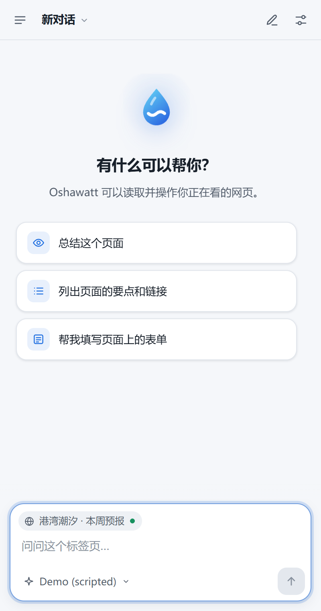
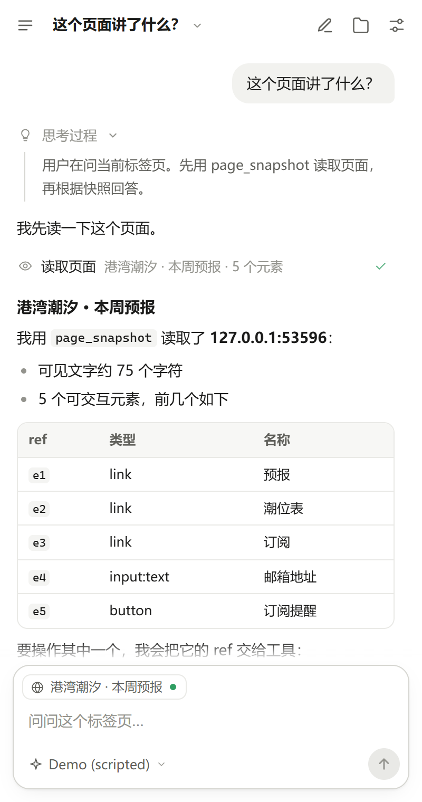
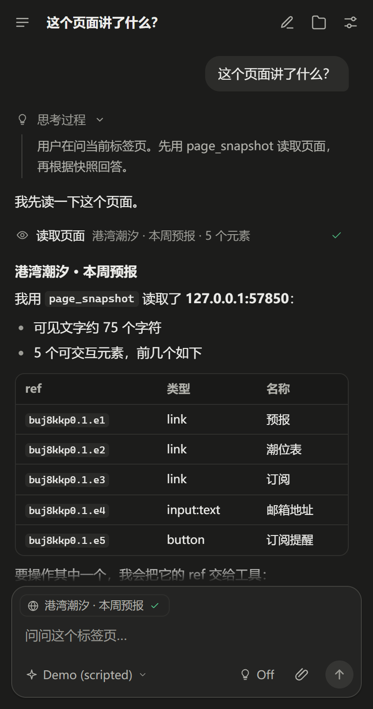
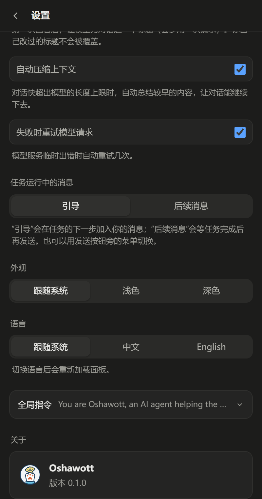
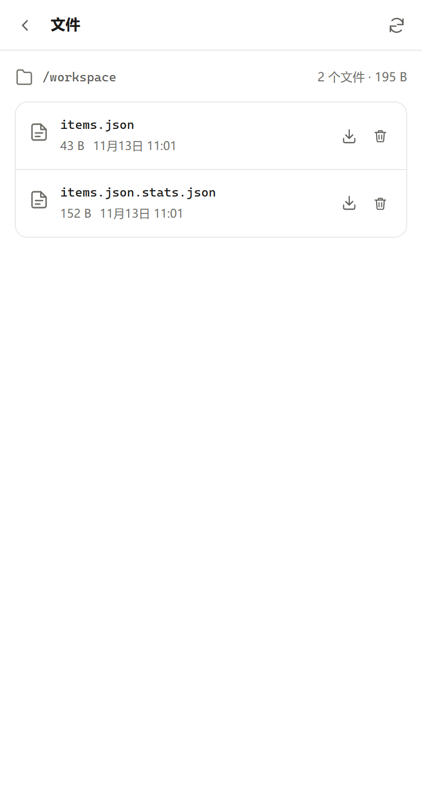

<p align="center">
  
</p>

<h1 align="center">Oshawott</h1>

水水獭（Oshawott）是基于 [Pi Durable](https://github.com/earendil-works/pi) 的浏览器 Agent 扩展，支持 Chromium 和 Firefox。

- **持续运行**：保存对话、工具调用和任务进度，浏览器重启后继续执行
- **网页操作**：读取页面、提取内容、操作元素和管理标签页，可为修改页面的操作开启确认
- **文件与 Code Mode**：每个对话都有独立的持久文件区，可以运行 JavaScript 处理文件和发起网络请求
- **多种模型**：支持 API Key、账号登录和自定义 OpenAI / Anthropic 兼容端点
- **侧边栏界面**：流式 Markdown、浅色 / 深色主题和中英文界面

| 空状态 | 对话 | 对话（深色） | 设置（深色） | 文件 |
|---|---|---|---|---|
|  |  |  |  |  |

## 快速开始

需要 Node.js 24 或更高版本，构建结果位于 `dist/chromium` 和 `dist/firefox`

```sh
npm install
npm run build
```

- **Chromium**：打开 `chrome://extensions`，开启开发者模式，加载 `dist/chromium`
- **Firefox**：打开 `about:debugging#/runtime/this-firefox`，加载 `dist/firefox/manifest.json`

这样加载的 Firefox 扩展在重启后失效。长期使用可从 [GitHub Releases](https://github.com/ming-kang/Oshawott/releases/latest) 下载：Chromium 加载解压的 zip；Firefox 安装经 AMO 签名的 xpi，之后自动更新。详见[分发](docs/distribution.md)。

## 许可

[MIT](LICENSE)
