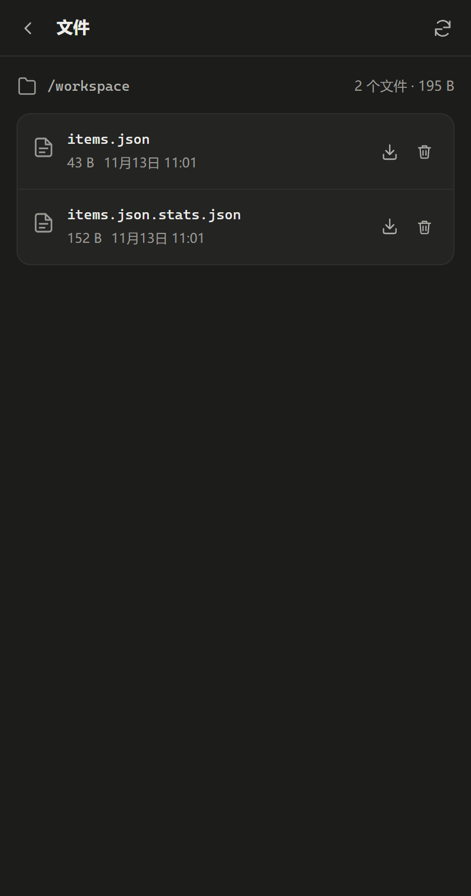

# Oshawott

> 正在开发中

水水獭/ Oshawott 是基于 [Pi Durable](https://github.com/earendil-works/pi) 的浏览器智能体扩展，同时支持 Chromium 和 Firefox。

- 对话、工具调用、运行状态记录在 Durable 中，可以随时恢复状态
- 模型通过页面工具读取和操作当前标签页（快照、点击、输入、滚动），列出标签页列表、打开新标签页
- Code Mode：模型通过在独立 Worker QuickJS 中运行的 JS 调用工具读写文件、处理数据
- 每个对话有独立的持久文件区，Engine 被回收或浏览器重启后仍保留，面板可以下载和删除文件。
- `fetch`：访问已授权的站点，下载文件
- 支持多种 LLM API，由 `Pi-AI` 提供支持
- 侧边栏界面：流式渲染 Markdown；浅色和深色主题；中英双语界面

| 空状态 | 对话 | 对话（深色） | 设置（深色） |
|---|---|---|---|
|  |  |  |  |

## 快速开始

```sh
npm install
npm run build                       # 普通构建：dist/chromium 和 dist/firefox
node scripts/build.mjs --dev        # 开发构建：带全站权限、source map 和测试钩子
```

加载扩展：

- **Chromium**：打开 `chrome://extensions`，开启开发者模式，载入 `dist/chromium`
- **Firefox**：打开 `about:debugging#/runtime/this-firefox`，载入 `dist/firefox/manifest.json`

### 文件与下载

| 文件（浅色） | 文件（深色） |
|---|---|
|  |  |

## 许可

[MIT LICENSE](LICENSE)
