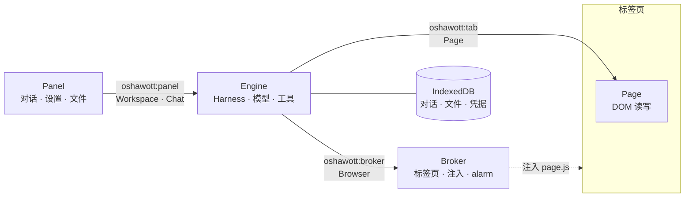
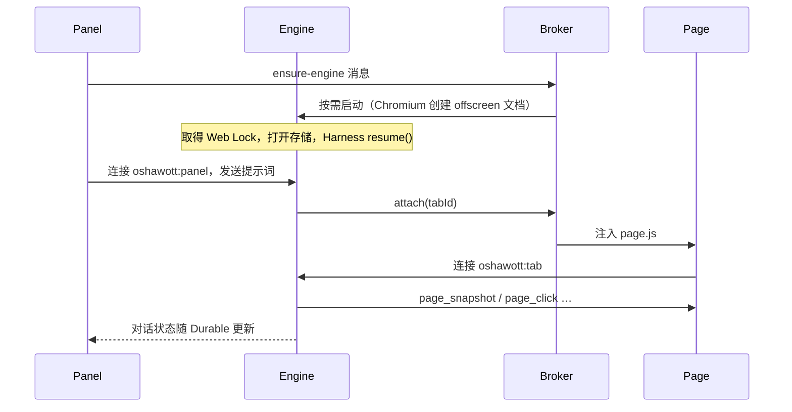

# 架构

Oshawott 把 Agent 核心、浏览器操作、用户界面和页面 DOM 拆成四个组件，组件之间通过 chord 远程对象通信。共享契约位于 `src/contracts/`。

| 组件 | 职责 | 运行位置 |
|:-:|:-:|:-:|
| **Engine** | 对话、模型、工具、文件和凭据 | Chromium offscreen 文档；Firefox 事件页 |
| **Broker** | 标签页、页面脚本注入和定时唤醒 | Chromium Service Worker；Firefox 事件页 |
| **Panel** | 侧边栏中的对话、设置和文件界面 | Chromium side panel；Firefox sidebar |
| **Page** | 页面工具的 DOM 实现 | 按需注入标签页 |

## 边界

`src/` 按运行位置、组件职责划分：
- `entries/` 启动并组合组件
- `contracts/` 定义跨组件的序列化契约
- 跨组件调用通过 `contracts/` 中定义的主机和引用进行

## 连接

箭头表示调用方向，连线上是 Port 名称。Firefox 中 Engine 与 Broker 同在事件页，直接在内存中连接。

## 一次页面工具调用

后台被回收时，Broker 用 alarm `oshawott:wake` 唤醒 Engine，Harness 从最后一次提交继续运行。
