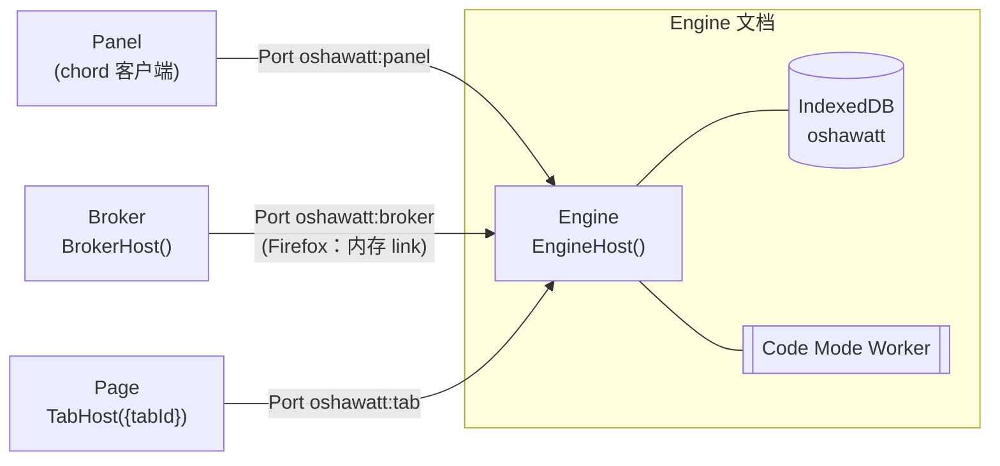

# 架构

Oshawatt 把扩展拆成四个角色，角色之间用 chord 对象通信。对话、运行状态与配置由 Pi Durable 持久化；文件和凭据分别存入 Engine 管理的独立 IndexedDB。浏览器随时可能回收扩展的后台上下文，所以设计上不靠保活，而是“随时可能被回收，回来后接着做”。

角色间通信见 [契约与连接](contracts.md)；各子系统见 [工具](tools.md)、[面板](panel.md)；安全边界见 [安全](security.md)；构建与开关见 [开发](development.md)。

## 角色与放置

| 角色 | 职责 | Chromium | Firefox |
|:-:|---|---|---|
| **Engine** | Durable Harness、模型调用、工具、全部持久状态 | offscreen 文档 `engine.html` | 事件页 `background.js` |
| **Broker** | 浏览器能力：标签页、脚本注入、alarms | Service Worker `background.js` | 与 Engine 同一个事件页 |
| **Panel** | 对话界面 | side panel | sidebar |
| **Page** | 页面工具的 DOM 实现 | 内容脚本 `page.js`，按需注入 | 同左 |

角色代码在两端完全相同，只有 `src/entries/` 决定放在哪里。Firefox 上 Broker 和 Engine 在同一个文档里，但仍然是两个 chord 宿主，用 `memoryLinkPair` 相连，上层代码不需要区分浏览器。

Chromium 把 Engine 放在 offscreen 文档，是因为 Engine 需要 DOM 环境里的 Worker（Code Mode）和长时间的流式请求，SW 不适合；而 offscreen 文档只有 `runtime` API，所以浏览器能力交给 Broker。

## 连接

**Engine 是唯一注册 `runtime.onConnect` 的上下文**，其他上下文都主动连接它。原因有两个：

- Firefox 上一个 Port 只要有任一接收方卸载就会断开，所以只保留一个接收方。
- offscreen 文档不能调用 `tabs.connect`，Engine 无法主动连接标签页。

Port 的发起方和 chord 的调用方不一定是同一端：

| 连接 | Port 发起方 | 谁调用谁 | 何时建立 |
|:-:|---|---|---|
| 面板 ↔ Engine | 面板 | 面板调用 Engine 的 `Workspace`、`Chat`（Engine `accept` 面板为子连接） | 面板打开时；断开后指数退避重连 |
| Broker ↔ Engine | Broker | Engine 调用 `Browser`（Engine 的 route 到 `BrokerHost`） | Engine 需要时发 `wakeBroker` 消息拉起；或 alarm 触发 |
| 页面 ↔ Engine | 内容脚本 | Engine 调用 `Page`（Engine 的 route 到 `TabHost({tabId})`） | Engine 需要某个标签页时，由 Broker 注入 `page.js` |

Port 的命名与发送方校验、Link 的帧格式、唤醒用的两条一次性消息，见 [契约与连接](contracts.md)。

## 状态

- **对话与配置在 Durable 里**（IndexedDB 数据库 `oshawatt`），同一份存储、同一条提交线：
  - 对话记录和运行状态：Durable 自带。
  - `WorkspaceDoc`（session 作用域）：对话列表、默认模型、待完成的文件删除意图（Engine 启动时重试清理）。
  - `TargetDoc`（conversation 作用域）：这个对话的页面工具默认作用于哪个标签页，即最近一次发送时面板所在的标签页，或 `tab_open` 打开的标签页。
- **文件**在独立数据库 `oshawatt-files`：每个对话一棵目录树，元信息与字节分开，键为 `[conversationId, path]`。文件事务不与 Durable 的对话提交原子绑定，见 [文件与 fetch](files.md)。
- **凭据**在单独的 IndexedDB 数据库 `oshawatt-credentials`，实现 pi-ai 的 `CredentialStore`，只在 Engine 文档里读写。
- **Broker、Page、Panel 不持有对话或工具的持久业务状态**，被回收后直接重建；面板仅在本地保存主题。
- **面板看到的就是 Durable 的状态**：Engine 用 `self.follow(observeDoc / observeConversation)` 把它暴露成 chord state，先发一次全量，之后只发增量。没有第二份副本，也没有事件广播。流式中的回答、运行中的工具、失败原因都来自 `pi.live` 文档。
- 只有提供商列表（含是否已配置 key）是 Engine 内存里的 chord state，在面板连上时和 `setApiKey` 后刷新。

## 生命周期

**启动（以 Chromium 为例）**

1. 面板打开，发 `ensureEngine`。SW 被唤醒，如果没有 offscreen 文档就创建 `engine.html`。
2. 面板连接 `oshawatt:panel`。Engine 的 `onConnect` 在文档同步阶段就已注册；Engine 还没就绪时先把面板排队。
3. Engine 获取 Web Lock `oshawatt:engine`，保证同一配置下只有一个 Engine；之后打开存储、`Harness.open`、`resume()`，再接入排队的面板。
4. 模型调用页面工具时，Engine route 到 `TabHost({tabId})`。如果这个标签页还没有连上来的 Port，Engine 先等待，同时让 Broker `attach`；Broker 不在线时 Engine 先发 `wakeBroker` 把它拉起。Broker 注入 `page.js`，内容脚本连接 `oshawatt:tab`，route 完成。

**回收与唤醒**

- Durable 通过 `onWake` 告诉 Engine 何时需要再次运行，Engine 转给 `Browser.armWake`。Broker 据此设置 alarm `oshawatt:wake`：运行中每 60 秒一次心跳；有定时任务时在 `at`；两者都有取较早者；都没有就清除。
- alarm 触发：Chromium 上 SW 重建 offscreen 文档并连接 Engine；Firefox 上唤醒事件页本身就会启动 Engine。Engine 重开后 `resume()`，从最后一次提交继续。
- 被打断的工具调用：Durable 在 `execute()` 之前记录调用意图，重启后只有 `replay: "safe"` 的工具会重跑；有副作用的工具不会重复执行，模型会收到 `interrupted`。
- 面板这边：Port 断开时 chord 引用变为 `loading` 并保留旧值；面板重连到新 Engine 后自动重新 hold，界面不需要特殊处理。
- 内容脚本：Port 断开后只等待；Engine 下次需要时 Broker 会再次注入，重复注入只重连，不会在页面里起第二个宿主。
