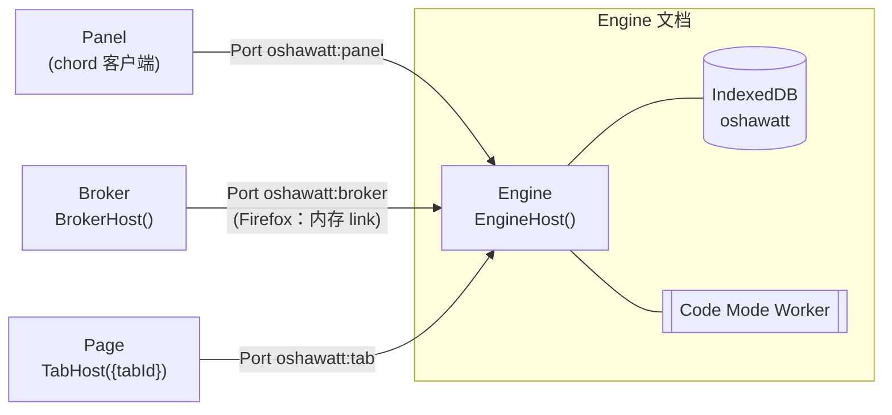

# 架构

Oshawatt 把扩展拆成四个角色。所有角色之间都用 chord 对象通信，所有需要持久化的状态都放在 Pi Durable 里。浏览器随时可能回收扩展的后台上下文，所以设计上不靠保活，而是“随时可能被回收，回来后接着做”。

## 角色与放置

| 角色 | 职责 | Chromium | Firefox |
|---|---|---|---|
| **Engine** | Durable Harness、模型调用、工具、全部持久状态 | offscreen 文档 `engine.html` | 事件页 `background.js` |
| **Broker** | 浏览器能力：标签页、脚本注入、alarms | Service Worker `background.js` | 与 Engine 同一个事件页 |
| **Panel** | 对话界面 | side panel | sidebar |
| **Page** | 页面工具的 DOM 实现 | 内容脚本 `page.js`，按需注入 | 同左 |

角色代码在两端完全相同，只有 `src/entries/` 决定放在哪里。Firefox 上 Broker 和 Engine 在同一个文档里，但仍然是两个 chord 宿主，用 `memoryLinkPair` 相连，上层代码不需要区分浏览器。

Chromium 把 Engine 放在 offscreen 文档，是因为 Engine 需要 DOM 环境里的 Worker（Code Mode）和长时间的流式请求，SW 不适合；而 offscreen 文档只有 `runtime` API，所以浏览器能力交给 Broker。

## 连接

**Engine 是唯一注册 `runtime.onConnect` 的上下文**，其他上下文都主动连接它。原因有两个：

- Firefox 上一个 Port 只要有任一接收方卸载就会断开，所以只保留一个接收方。
- offscreen 文档不能调用 `tabs.connect`，Engine 无法主动连接标签页。

Port 的发起方和 chord 的调用方不一定是同一端：

| 连接 | Port 发起方 | 谁调用谁 | 何时建立 |
|---|---|---|---|
| 面板 ↔ Engine | 面板 | 面板调用 Engine 的 `Workspace`、`Chat`（Engine `accept` 面板为子连接） | 面板打开时；断开后指数退避重连 |
| Broker ↔ Engine | Broker | Engine 调用 `Browser`（Engine 的 route 到 `BrokerHost`） | Engine 需要时发 `wakeBroker` 消息拉起；或 alarm 触发 |
| 页面 ↔ Engine | 内容脚本 | Engine 调用 `Page`（Engine 的 route 到 `TabHost({tabId})`） | Engine 需要某个标签页时，由 Broker 注入 `page.js` |

**Port 上的 Link**（`src/link/port-link.ts`）：

- Chromium 的 Port 消息按 JSON 序列化，所以每帧用 base64 字符串传输。
- Port 事件没有缓冲，所以 Port 一到达就包成 Link，监听器设置之前到的消息排队。
- chord 独占 Link 的 `onClose`，所以 Link 另外暴露 `done`，供应用判断何时重连。

**`onConnect` 按 Port 名分流，并校验发送方**：

- `oshawatt:tab`：必须来自标签页的顶层 frame（`frameId === 0`）。
- `oshawatt:panel`：必须来自本扩展的 `panel.html`。
- `oshawatt:broker`：必须来自本扩展，且不能来自标签页。
- 其他名字直接断开。

两条一次性消息（`MESSAGES`）用来唤醒后台：`ensureEngine`（面板请求 Broker 确保 Engine 文档存在）和 `wakeBroker`（Chromium 上 Engine 请求 SW 连回来）。

## 契约

全部定义在 `src/contracts/`，chord 按契约检查参数和返回值。

| 对象 | 所在宿主 | 调用方 | 内容 |
|---|---|---|---|
| `Workspace` | Engine | 面板 | state：`chats`、`defaultModel`、`providers`；方法：`createChat`、`setApiKey`、`setDefaultModel` |
| `Chat({id})` | Engine | 面板 | state：`view`（Durable 的 `ConversationView`）；方法：`send`、`abort`、`reset`、`configure`、`entries` |
| `Browser` | Broker | Engine | `listTabs`、`activeTab`、`openTab`、`attach`、`armWake` |
| `Page({tabId})` | Tab | Engine | `page_snapshot`、`page_click`、`page_type`、`page_scroll` |

身份（`Principal`）由接收连接的一方在 `accept` / `connect` 时标记，调用方不能自报身份：

- `Workspace`、`Chat` 只服务 `panel`，其他身份收到 `forbidden`。
- `Browser`、`Page` 只服务 `engine`。
- Engine 到 `BrokerHost`、`TabHost` 的 route 只放行 Engine 自己发起的 hold，所以面板不能借 Engine 访问标签页或浏览器 API（有单元测试覆盖）。

## 状态

- **持久状态全部在 Durable 里**（IndexedDB 数据库 `oshawatt`），同一份存储、同一条提交线：
  - 对话记录和运行状态：Durable 自带。
  - `WorkspaceDoc`（session 作用域）：对话列表、默认模型。
  - `TargetDoc`（conversation 作用域）：这个对话的页面工具默认作用于哪个标签页，即最近一次发送时面板所在的标签页，或 `tab_open` 打开的标签页。
- **凭据**在单独的 IndexedDB 数据库 `oshawatt-credentials`，实现 pi-ai 的 `CredentialStore`，只在 Engine 文档里读写。
- **Broker、Page、Panel 不持有需要保留的状态**，被回收后直接重建即可。
- **面板看到的就是 Durable 的状态**：Engine 用 `self.follow(observeDoc / observeConversation)` 把它暴露成 chord state，先发一次全量，之后只发增量。没有第二份副本，也没有事件广播。流式中的回答、运行中的工具、失败原因都来自 `pi.live` 文档。
- 只有提供商列表（含是否已配置 key）是 Engine 内存里的 chord state，在面板连上时和 `setApiKey` 后刷新。

## 生命周期

**启动（以 Chromium 为例）**

1. 面板打开，发 `ensureEngine`。SW 被唤醒，如果没有 offscreen 文档就创建 `engine.html`。
2. 面板连接 `oshawatt:panel`。Engine 的 `onConnect` 在文档同步阶段就已注册；Engine 还没就绪时先把面板排队。
3. Engine 获取 Web Lock `oshawatt:engine`，保证同一配置下只有一个 Engine；之后打开存储、`Harness.open`、`resume()`，再接入排队的面板。
4. 模型调用页面工具时，Engine route 到 `TabHost({tabId})`。如果这个标签页还没有连上来的 Port，Engine 先等待，同时让 Broker `attach`；Broker 不在线时 Engine 先发 `wakeBroker` 把它拉起。Broker 注入 `page.js`，内容脚本连接 `oshawatt:tab`，route 完成。

**回收与唤醒**

- Durable 通过 `onWake` 告诉 Engine 何时需要再次运行，Engine 转给 `Browser.armWake`。Broker 据此设置 alarm `oshawatt:wake`：运行中每 60 秒一次心跳；有定时任务时在 `at`；两者都有取较早者；都没有就清除。
- alarm 触发：Chromium 上 SW 重建 offscreen 文档并连接 Engine；Firefox 上唤醒事件页本身就会启动 Engine。Engine 重开后 `resume()`，从最后一次提交继续。
- 被打断的工具调用：Durable 在 `execute()` 之前记录调用意图，重启后只有 `replay: "safe"` 的工具会重跑；有副作用的工具不会重复执行，模型会收到 `interrupted`。
- 面板这边：Port 断开时 chord 引用变为 `loading` 并保留旧值；面板重连到新 Engine 后自动重新 hold，界面不需要特殊处理。
- 内容脚本：Port 断开后只等待；Engine 下次需要时 Broker 会再次注入，重复注入只重连，不会在页面里起第二个宿主。

## 工具

- **页面工具只在 `src/tools/page-tools.ts` 声明一次**：描述、参数、返回值、`replay` 策略写在一起。`Page` 契约和 Durable 工具都从这里生成；读操作（快照、滚动）是 `safe`，有动作的（点击、输入）是 `unsafe`。
- 每个页面工具都多一个可选参数 `tabId`。目标标签页的确定顺序：调用时指定的 `tabId` → 对话的 `TargetDoc` → 当前活动标签页。
- 元素引用（`ref`）只存在内容脚本内存里的 `WeakRef` 表中，不写进页面 DOM，页面脚本读不到也伪造不了；下次快照或页面导航后失效。
- 浏览器工具：`tabs_list`；`tab_open` 打开标签页并把它设为对话的目标标签页。
- **Code Mode**：`RemoteCodemodeSandbox` 留在 Engine 里管理工具和调用记录，QuickJS 在专用 Worker 里运行，每次执行新建 Worker，结束即 terminate。不需要 SharedArrayBuffer，所以两端都能用；扩展 CSP 只额外放开 `wasm-unsafe-eval`。

## 安全边界

- 身份由连接接收方标记，各对象按身份拒绝访问（见[契约](#契约)）；`onConnect` 校验 Port 发送方。
- API key 从面板经 `setApiKey` 写入，此后只在 Engine 文档里使用，面板只能看到“是否已配置”。key 以明文保存在扩展自己的 IndexedDB 中。
- 面板只用 `textContent` 渲染，不会把模型或网页返回的 HTML 插进界面。
- 内容脚本运行在隔离世界（isolated world），只在 Engine 需要时注入，不在清单里声明任何站点。
- 权限：`tabs`、`scripting`、`activeTab`、`alarms`，Chromium 另加 `offscreen`、`sidePanel`。host 权限只包括五个模型 API 的域名；`<all_urls>` 只出现在 `optional_host_permissions` 中，需要运行时申请。开发构建为方便自动测试会直接带上 `<all_urls>`。

## 构建期区分

- `__OSHAWATT_TARGET__`（`chromium` / `firefox`）在构建时固定，每个包只含自己浏览器的分支。
- `__OSHAWATT_DEV__` 只在 `--dev` 构建中为真。测试钩子写在 `if (__OSHAWATT_DEV__)` 块里，正式构建会把整块删掉。
- 清单由 `src/manifest.ts` 按目标生成。
- chord 只从 `src/lib/chord.ts` 引入。当前 chord 1.5.0 的新版 API 在 `@earendil-works/chord/next`，上游后续版本会移到根入口，届时只改这一个文件。

## 已知限制

- **还没有用真实模型做端到端验证**：真实的流式请求、跨域请求、带页面工具的多轮对话都待验证。
- **正式构建没有申请站点权限的界面**，在未授权的站点上注入页面工具会失败。
- 没有 OAuth 登录，只支持 API key。
- 面板不分页加载更早的历史，只显示 Durable view 窗口内的记录。
- Chromium 上 offscreen 文档空闲时不会自动关闭。
- 未验证：Firefox 侧边栏关闭后长时间运行的任务；chord 的心跳是否会让 SW 一直不休眠。
- 没有 Linux 沙箱：Firefox 扩展页没有跨源隔离，计算类任务交给 Code Mode。
- Firefox 附加组件 ID `oshawatt@example.org` 是占位值；AMO 要求的 `data_collection_permissions` 未填写；没有图标和多语言。
