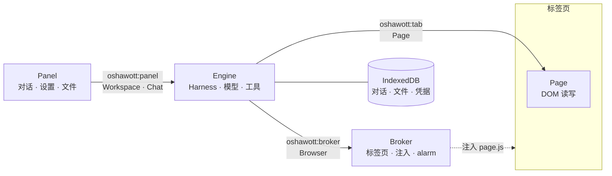
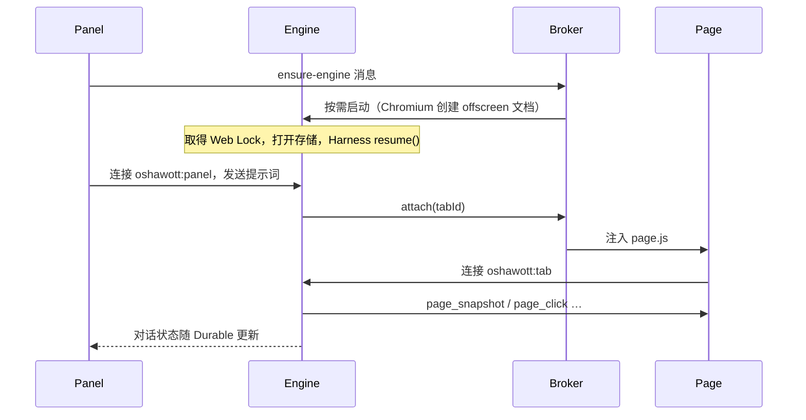

# 架构

Oshawott 将 Agent 核心、浏览器操作、用户界面和页面 DOM 拆成四个组件，组件之间通过 chord 远程对象通信

共享契约位于 `src/contracts/`

| 组件 | 职责 | 运行位置 |
|:-:|:-:|:-:|
| **Engine** | 对话、模型、工具、文件和凭据 | Chromium offscreen 文档；Firefox 事件页 |
| **Broker** | 标签页、页面脚本注入和定时唤醒 | Chromium Service Worker；Firefox 事件页 |
| **Panel** | 侧边栏中的对话、设置和文件界面 | Chromium side panel；Firefox sidebar |
| **Page** | 页面工具的 DOM 实现 | 按需注入标签页 |

## 边界

`src/` 按运行位置、组件职责划分：
- `entries/` 启动并组合组件
- `contracts/` 定义跨组件的序列化契约
- 跨组件调用通过 `contracts/` 中定义的主机和引用进行

## 连接

箭头表示调用方向，连线上是 Port 名称。Firefox 中 Engine 与 Broker 同在事件页，直接在内存中连接

## 流程示例

后台被回收时，Broker 用 alarm `oshawott:wake` 唤醒 Engine，Harness 从最后一次提交继续运行

## Panel 状态与组件

Panel 使用 Vue 3 的 TSX，而不是 SFC：项目由 TypeScript 7 直接执行类型检查，当前 `vue-tsc` 不能消费这一编译器。TSX 同时保留现有 `tsc --noEmit` 和 esbuild 工具链，运行时不需要模板编译或 CSP 禁止的动态代码生成

Chord 引用仍由 `ChatSession` 持有，`PanelStore` 只发布组件需要的派生值。切换对话、发送和草稿代次由 controller 协调；组件不持有第二份 durable 状态。流式更新按帧合并，未变化的文档和设置不应引起无关重绘

Transcript 使用 Durable 的 `ConversationTranscript` 合并观察窗口、按需读取更早条目并填补重连缺口。观察窗口不是完整历史，渲染器不得假定它总能看到第一条消息或工具调用

## 回答渲染

Markdown 解析使用 `stream-markdown-parser`，DOM 由 Panel 自己维护
